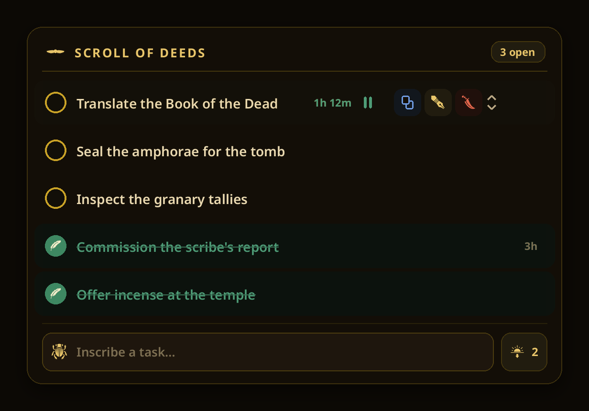
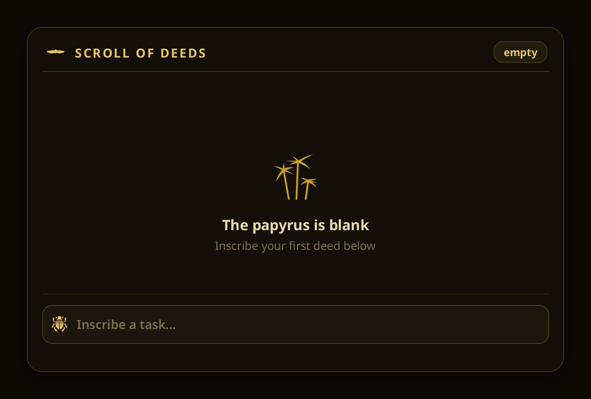

<div align="center">

# 𓋹 Scroll of Deeds

**A pharaonic-themed to-do manager for the GNOME top bar.**
Timers, reordering, and a tomb-gold palette — click the Eye of Horus and get to work.




</div>

## Features

- **Round malachite "seal" checkbox** — a task marked done bears the Feather of Ma'at.
- **Per-task stopwatch** with live seconds; time keeps counting even while the
  menu is closed. A completed task keeps its final time, read-only.
- **Copy, edit in place, delete** (a flint blade), and **reorder** up or down.
- **Hover to reveal** a row's controls; long task text shows a full-text tooltip.
- **Clear completed** as a gentle "send to the West" (sunset), with a confirm card.
- One coherent palette: **gold, lapis lazuli, malachite, carnelian, papyrus cream**
  on a tomb-black ground — the pigments of high New Kingdom jewelry.

## Screenshots

| Tasks, timer & controls | Empty state |
| --- | --- |
|  |  |

## Requirements

GNOME Shell **45, 46, 47, or 48**.

## Install

### From source

```bash
ln -s "$PWD" "$HOME/.local/share/gnome-shell/extensions/gnome-todo@claudeai"
gnome-extensions enable gnome-todo@claudeai
```

Then reload the shell: **log out and back in** on Wayland, or press
<kbd>Alt</kbd>+<kbd>F2</kbd> → <kbd>r</kbd> on Xorg.

### From a package

```bash
gnome-extensions install --force gnome-todo@claudeai.shell-extension.zip
```

## Where your tasks live

Tasks are stored in `~/.config/scroll-of-deeds/tasks.json`, **outside** the
extension folder, so updating the extension never erases them. Data from an
older build (kept inside the extension folder) migrates automatically on first run.

## Publishing to extensions.gnome.org

The upload package is already built as `gnome-todo@claudeai.shell-extension.zip`.
To rebuild it after changes:

```bash
gnome-extensions pack --force --extra-source=icons .
```

Then:

1. Sign in at <https://extensions.gnome.org>.
2. Optionally add a `url` (your repo) to `metadata.json`.
3. Upload the zip at <https://extensions.gnome.org/upload/> and await review.

It already meets the review guidelines: readable code, no network access, clean
teardown in `disable()`, and bundled-glyph licensing credited in
`icons/CREDITS.txt`. extensions.gnome.org assigns the published version number,
so `version` in `metadata.json` need not be bumped by hand.

> **Note on the UUID.** `gnome-todo@claudeai` uses a placeholder domain. It is
> accepted as-is; if you'd prefer `scroll-of-deeds@yourhandle`, rename the folder
> and the `uuid` field to match, then re-package.

## Project layout

```
extension.js      · the indicator, menu, tasks, timers, and storage
stylesheet.css    · the pharaonic theme
metadata.json     · UUID, name, supported shell versions
icons/            · pharaonic glyphs (*-symbolic.svg) + CREDITS.txt
screenshots/      · images used in this README
```

## Credits & licence

Code is licensed **GPL-2.0-or-later** (see `LICENSE`), the conventional licence
for GNOME Shell extensions. The glyphs are derived from
[game-icons.net](https://game-icons.net) by **Lorc** and **Delapouite** under
[CC BY 3.0](https://creativecommons.org/licenses/by/3.0/); the winged sun-disk is
original work released CC0. Full attribution is in `icons/CREDITS.txt`.
