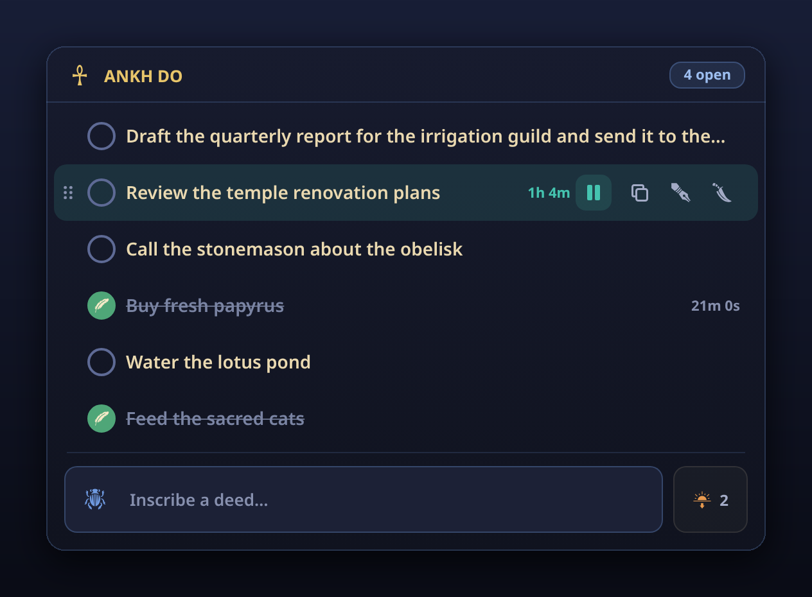
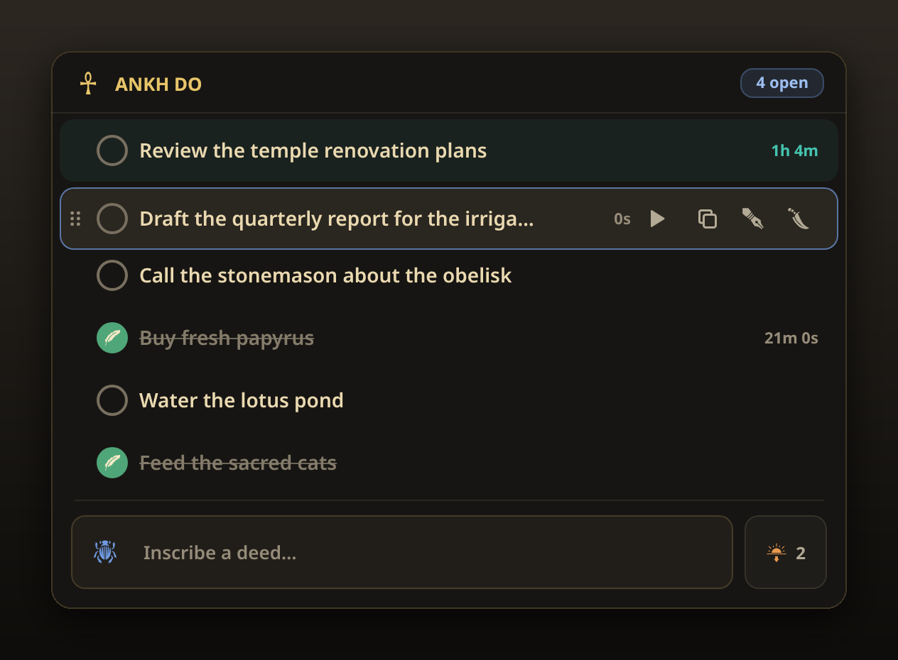
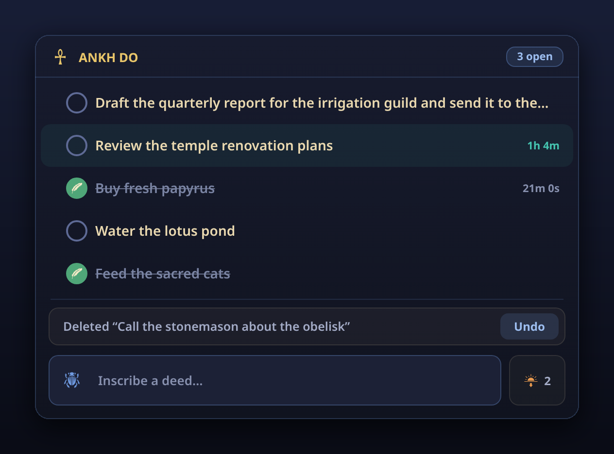

<div align="center">


# Ankh Do

**A pharaonic to-do list for your GNOME top bar and your Chrome toolbar.**<br>
Drag deeds into order, time them, undo mistakes — under a tomb-ceiling sky of lapis and gold.




</div>

## One list, two homes

Ankh Do lives in two places with the same design, features and keyboard
shortcuts:

- **GNOME Shell** — a white ankh with your open-task count in the top bar,
  sitting with the system indicators. Click it for the menu.
- **Chrome** — a gold-on-lapis ankh in the toolbar with a badge counting open
  tasks. Click it for the popup.

Each keeps its own list; they don't sync.

## Features

- **Drag to reorder.** Grab a task (or the grip that appears on hover) and drop
  it anywhere. The other tasks slide aside as you move.
- **A stopwatch per task.** Start, pause, resume. Time keeps counting while the
  menu is closed; a finished task keeps its final time.
- **Undo.** Deleted a task by mistake? An *Undo* bar waits for a few seconds.
- **Edit in place, copy, delete.** Controls appear when you hover a task (or
  focus it with the keyboard) and stay out of the way otherwise.
- **Fully keyboard-driven.** Every action has a key — see below.
- **Clear completed** with one click, after a gentle confirmation.
- **Calm by design.** Colour marks state, not decoration: turquoise for the task
  you're timing, malachite for the done seal, and button colours only under the
  pointer.

<table>
  <tr>
    <td width="33%"></td>
    <td width="33%"></td>
    <td width="33%"></td>
  </tr>
  <tr>
    <td align="center"><sub>Drag to reorder</sub></td>
    <td align="center"><sub>Undo a delete</sub></td>
    <td align="center"><sub>A blank papyrus</sub></td>
  </tr>
</table>

## Keyboard

Focus starts in the *Inscribe a deed…* field: type and press <kbd>Enter</kbd> to
add a task. Press <kbd>↑</kbd> to move into the list.

| Key | Action |
| --- | --- |
| <kbd>↑</kbd> <kbd>↓</kbd> | Move between tasks |
| <kbd>Alt</kbd> + <kbd>↑</kbd> <kbd>↓</kbd> | Move the task up or down |
| <kbd>Space</kbd> | Mark done / not done |
| <kbd>Enter</kbd> · <kbd>F2</kbd> · <kbd>E</kbd> | Edit — <kbd>Enter</kbd> saves, <kbd>Esc</kbd> cancels |
| <kbd>T</kbd> | Start or pause the timer |
| <kbd>C</kbd> | Copy the task's text |
| <kbd>Delete</kbd> | Delete (with undo) |
| <kbd>Esc</kbd> | Cancel an edit or confirmation; otherwise close |

## Install

### GNOME Shell

Requires GNOME Shell 45, 46, 47 or 48 (developed and tested on 48).

```bash
git clone https://github.com/TheSant0x/AnkhDo.git
ln -s "$PWD/AnkhDo" ~/.local/share/gnome-shell/extensions/ankh-do@thesant0x.github.io
gnome-extensions enable ankh-do@thesant0x.github.io
```

Then restart GNOME Shell: **log out and back in** on Wayland, or press
<kbd>Alt</kbd>+<kbd>F2</kbd>, type `r`, and press <kbd>Enter</kbd> on X11.

To try changes without logging out, run a nested shell and enable the
extension inside it:

```bash
dbus-run-session -- gnome-shell --nested --wayland
```

### Chrome

1. Open `chrome://extensions` and turn on **Developer mode**.
2. Click **Load unpacked** and choose the `chrome/` folder.
3. Pin Ankh Do from the puzzle-piece menu so the ankh stays in the toolbar.

After pulling changes, click the reload icon on the extension's card.

## Your data

Everything stays on your machine. Neither version makes network requests or
collects anything.

- **GNOME:** `~/.config/scroll-of-deeds/tasks.json` — outside the extension
  folder, so updates never erase it.
- **Chrome:** `chrome.storage.local`, scoped to your browser profile. The only
  permission requested is `storage`.

## Design

The palette is drawn from materials the Egyptians prized, and each colour has a
single job that matches what it meant to them.

| Colour | | Meaning | Used for |
| --- | --- | --- | --- |
| Night lapis | `#141829` | Nut's starry sky on tomb ceilings | The ground |
| Papyrus cream | `#EAD9B0` | The scroll | Text |
| Gold | `#E8C56A` | The flesh of the gods | The name and the ankh |
| Turquoise | `#45C4B0` | Hathor's faience | The task you're timing |
| Malachite | `#5FB98A` | *Wadj* — life, renewal | The done seal |
| Lapis lazuli | `#6F9AE0` | The gods' hair | Adding, copying, dragging |
| Silver | `#C3CCE0` | Thoth's moon, patron of scribes | Editing |
| Carnelian | `#E0654B` | *Desher* — chaos | Deleting |
| Sunset ochre | `#E89A4F` | The sun setting in the West | Clearing finished deeds |

Accents appear only where something is happening; everything at rest is quiet
slate and cream.

## Building & publishing

### GNOME Shell → extensions.gnome.org

```bash
gnome-extensions pack --force --extra-source=icons .
```

Check it with GNOME's static analyzer, then upload
`ankh-do@thesant0x.github.io.shell-extension.zip` at
<https://extensions.gnome.org/upload/>:

```bash
pip install -U shexli
shexli ankh-do@thesant0x.github.io.shell-extension.zip
```

The site assigns version numbers, so `metadata.json` needs no bump.

### Chrome → Chrome Web Store

```bash
cd chrome && zip -r ../ankh-do-chrome.zip . -x '*.DS_Store'
```

1. Register at the [Chrome Web Store Developer Dashboard](https://chrome.google.com/webstore/devconsole)
   (one-time US$5 fee).
2. **Add new item** and upload `ankh-do-chrome.zip`.
3. Listing: name **Ankh Do**, category **Productivity**, icon
   `chrome/icons/ankhdo-128.png`, and at least one 1280×800 screenshot.
4. Privacy: single purpose "a to-do list manager"; `storage` is used only to
   save tasks locally; no data is collected. The store also requires a privacy
   policy URL — a one-line page saying exactly that is enough.

Bump `version` in `chrome/manifest.json` for every store update.

## Project layout

```
extension.js          GNOME: indicator, menu, tasks, timers, drag, keyboard, storage
stylesheet.css        GNOME: the theme
metadata.json         GNOME: UUID, name, supported shell versions
icons/                GNOME: glyphs (*-symbolic.svg) and CREDITS.txt
chrome/
  manifest.json       Chrome: Manifest V3
  popup.html/.css/.js Chrome: the popup
  bg.js               Chrome: keeps the toolbar badge's count current
  glyphs.js           Chrome: the shared glyphs as inline SVG
  icons/              Chrome: toolbar icons, 16–128 px
screenshots/          images for this README
```

## Credits & licence

Code is licensed **GPL-2.0-or-later** — see [`LICENSE`](LICENSE) and
[`COPYING`](COPYING). Most glyphs are derived from
[game-icons.net](https://game-icons.net) by **Lorc** and **Delapouite** under
[CC BY 3.0](https://creativecommons.org/licenses/by/3.0/). The panel ankh, the
Chrome toolbar icons and the drag grip are original work released under CC0. Per-file attribution is in
[`icons/CREDITS.txt`](icons/CREDITS.txt).
